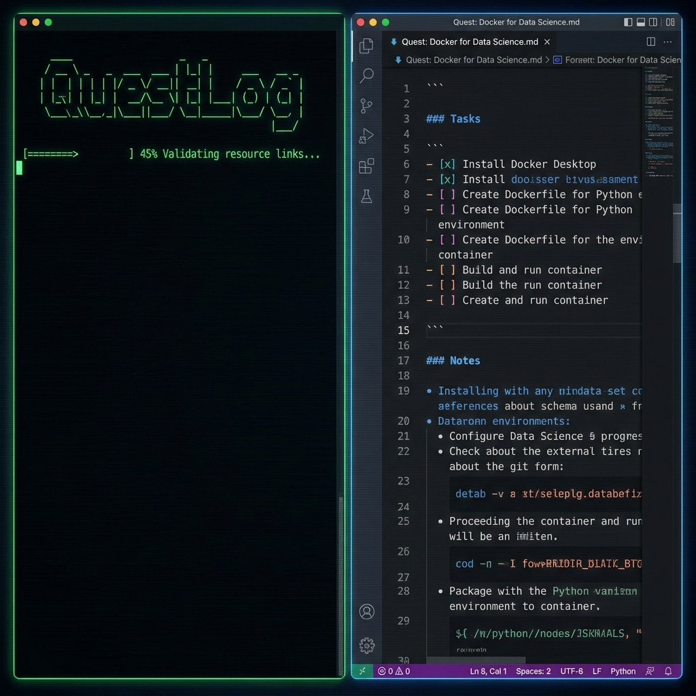

# QuestLog 🛡️📜

> **Generate infinite, trackable skill trees in Markdown. No login, no bloat.**



[](https://opensource.org/licenses/MIT)
[](https://www.python.org/downloads/release/python-390/)
[](https://github.com/psf/black)

**QuestLog** is a CLI tool that treats learning like an RPG quest. It processes your topic using Google's Gemini AI and generates a rigorous, multi-level curriculum ("Quest Log") directly into a Markdown file.

Unlike static roadmaps, QuestLog allows you to:
- **Track Progress Locally**: Uses standard GitHub task lists (`- [ ]`).
- **Fight Bosses**: Every level ends with a "Boss Fight" project to ensure you *build* what you learn.
- **Avoid Link Rot**: Automatically verifies that resource links are live (200 OK) before adding them.

---

## 🚀 Installation

Ensure you have Python 3.9+ installed.

```bash
git clone https://github.com/pronzzz/questlog.git
cd questlog
pip install -e .
```

## 🔑 Configuration

You will need a Google Gemini API Key. Get one for free at [Google AI Studio](https://aistudio.google.com/app/apikey).

```bash
export GEMINI_API_KEY="your_api_key_here"
```

## 🎮 Usage

Generate a new quest by checking the CLI help or running the command directly:

```bash
questlog new "Topic Name" --difficulty [novice|adept|master]
```

### Example: Docker for Data Science

```bash
python3 -m questlog.cli new "Docker for Data Science" --difficulty novice
# OR if installed to path:
questlog new "Docker for Data Science"
```

**Output**:
A file named `Quest-Docker-for-Data-Science.md` will be created in your current directory.

## 🛠️ Tech Stack

-   **Core**: Python 3.9+
-   **CLI**: `typer` + `rich`
-   **AI**: `google-generativeai` (Gemini Flash)
-   **Templating**: `jinja2`

## 🤝 Contributing

Contributions are welcome! Please fork the repository and submit a pull request.

1.  Fork the repo
2.  Create your feature branch (`git checkout -b feature/amazing-feature`)
3.  Commit your changes (`git commit -m 'Add some amazing feature'`)
4.  Push to the branch (`git push origin feature/amazing-feature`)
5.  Open a Pull Request

## 📄 License

Distributed under the MIT License. See `LICENSE` for more information.
